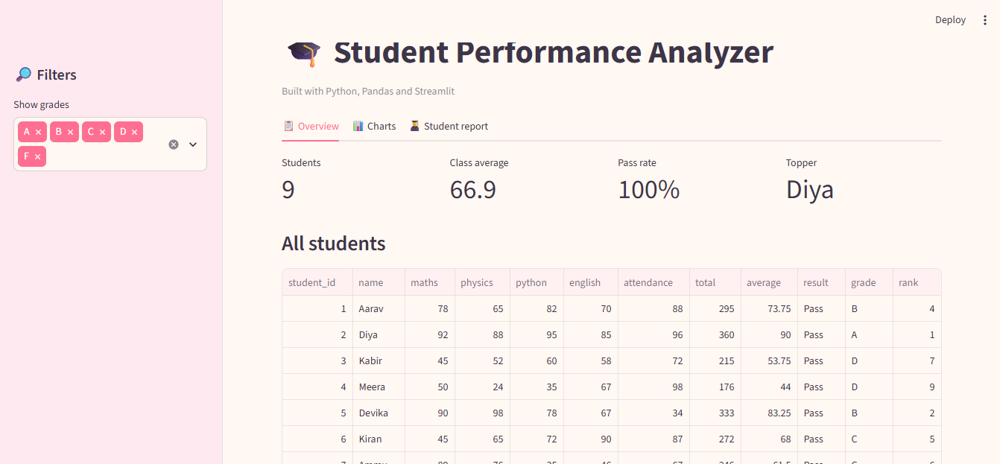
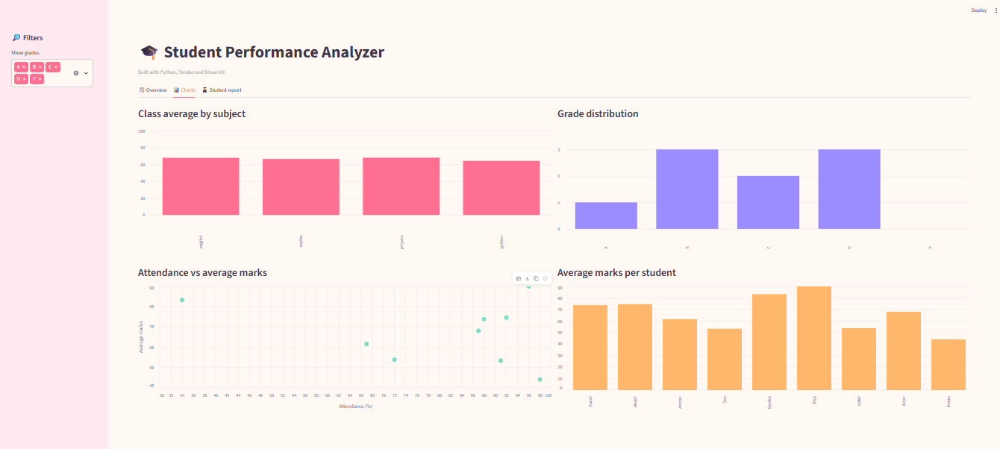
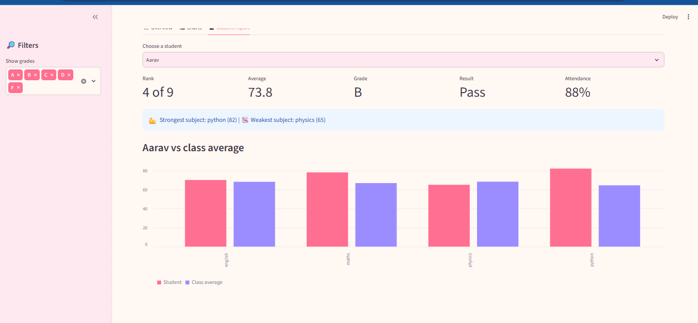

# Student Performance Analyzer

A dashboard that shows how a class is performing. It reads student marks and attendance, works out each student's total, average and grade, and shows the results in charts, tables and individual student reports.

## Features

- Class summary with the number of students, class average, pass rate and topper
- Interactive charts for subject averages, grade distribution, attendance vs marks, and each student's average
- Individual student report with rank, grade, strongest and weakest subject, and a low-attendance warning
- Sidebar filter to show only the grades you choose
- Automatic data cleaning, plus tests that check the data is valid

## Tech stack

- Python
- Pandas and NumPy for data cleaning and analysis
- Streamlit for the dashboard
- Altair for the interactive scatter chart
- Git and GitHub for version control
- Built in the Google Antigravity IDE

## Screenshots

### Overview

The Overview tab shows the class summary (number of students, class average, pass rate and topper) and a sortable table of every student with their total, average, grade and rank.

### Charts

Four interactive charts: class average by subject, grade distribution, attendance vs average marks, and the average of every student. Hover over any bar or dot to see its exact values.

### Student report

Pick any student to see their rank, average, grade, result and attendance, their strongest and weakest subject, a low-attendance warning when needed, and a chart comparing their marks with the class average.